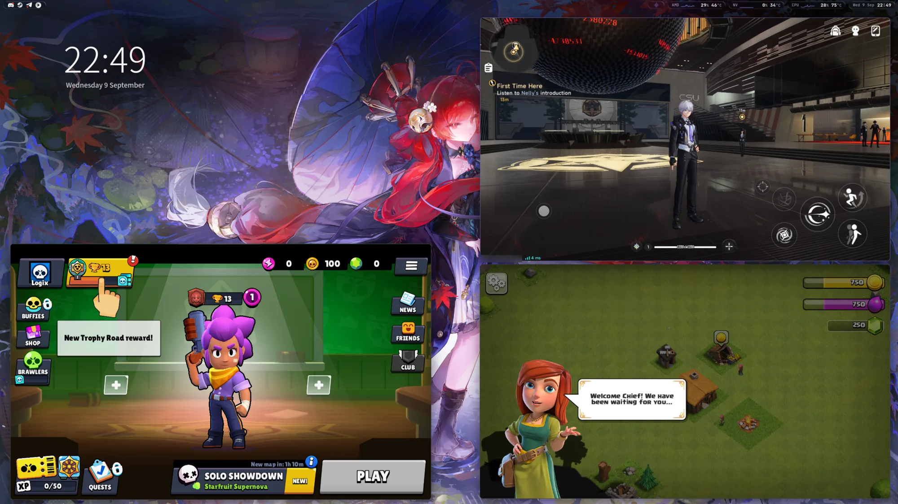
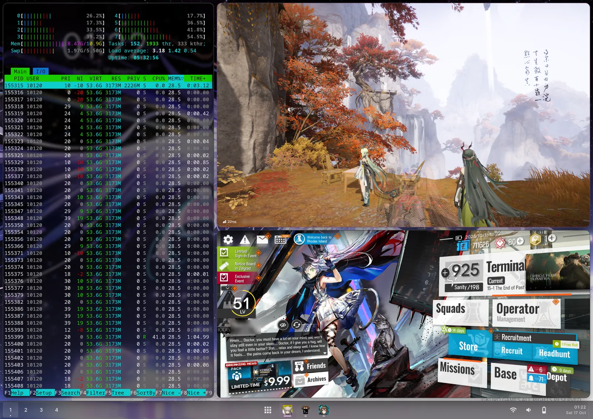

# Droidloom

**Android apps, with Linux in charge.**

Droidloom puts Android 17 apps in real Wayland windows, right next to your Linux
apps. Tile a game. Paste a screenshot into WhatsApp. Open the file you just saved
in Downloads. Use your desktop's keyboard, notifications, audio and fingerprint
reader. Android runs on your Linux kernel, with no virtual machine and no
emulator, and follows your desktop's rules.

GPU acceleration on AMD, Intel and **NVIDIA**. ARM64 games on x86_64 with **Teto
built in**. Android boots in **about a second on a desktop PC** and **about five
seconds on mobile**.

<p align="center">
  
  <br>
  <em>Brawl Stars, Neverness to Everness and Clash of Clans on an x86_64 desktop.
  All three are ARM64 builds, translated by Teto.</em>
</p>

Available as an **early preview** for x86_64 Arch Linux and aarch64 Arch Linux
ARM. **[Install it](#install-the-preview)** ·
**[Latest release](https://github.com/denialwm/droidloom/releases/latest)**

## Yes, NVIDIA too.

Android's Vulkan runs on your host's NVIDIA driver through
[GPU forwarding](docs/gpu-forwarding.md). OpenGL ES 3.2 runs through ANGLE on
the same path. Droidloom handles Android's texture formats and video buffers;
your GPU does the rendering. Setup enables forwarding automatically on x86_64
when it finds an NVIDIA card. AMD and Intel render natively with Mesa.

Have more than one GPU? `droidloomctl gpu` lists them and lets you choose.

## Boot fast. Get on with it.

Android boots in **about a second on a desktop PC** and **about five seconds on
mobile devices**, with starts as low as **1.5 seconds on Snapdragon 8 Elite
Gen 5**. The first start takes longer while Android prepares its data and
verifies images.

Droidloom runs Android's own userspace—ART, Binder, Zygote and system_server—on
your Linux kernel, in its own namespaces. Apps show up in `htop` as ordinary
processes. Start the runtime with `droidloomctl start`, then launch apps from
your desktop.

## Windows that know how to behave.

Every Android task gets its own Android display, sized to its own Wayland
window. Your compositor sees the app's actual bounds and owns its decorations.
Tile it, snap it, resize it, move it between workspaces. Android lays the app
out at the new size, and input goes to that app's display.

Desktop mode opens phone-sized windows and remembers each app's size. Mobile
mode fills the screen. Choose per app; density follows the output the window
is on.

<p align="center">
  
</p>

## Your system. All the way through.

- **Your launcher.** Android apps appear with their names and icons, updated
  as you install and remove them.
- **Your clipboard.** Text, links, HTML, images and copied files move both ways
  between Android and Linux apps, where the receiving app supports the format.
- **Your notifications.** Android notifications use the desktop notification
  service. Clicks and actions open the app; dismissing one on the desktop
  clears it in Android.
- **Your files.** Android's Download, Pictures, Documents, Music and Movies
  are your Linux folders, shared automatically. Files saved on Linux appear
  in Android's gallery and file pickers.
- **Your keyboard.** Text fields use the compositor's input method through
  `zwp_text_input_v3`. Android never draws a keyboard of its own.
- **Your audio.** Sound goes through PipeWire, with loudness controlled by the
  host mixer. The microphone stays off until you allow it.
- **Your fingerprints.** Android biometric requests use fingers already
  enrolled with the host's `fprintd`. On Denial, the compositor lights and marks
  the sensor as it does on the lock screen.
- **Your lock screen.** Android follows the host session's lock state through
  logind, locking Keystore keys that require an unlocked device.
- **Your cameras and haptics.** On phones running Phonewave, Android apps take
  photos and previews with the phone's cameras through its camera service,
  `braun`, and vibrate through its haptics service, `hapticd`.
- **Your tools.** `droidloomctl logs` and `droidloomctl crashes` work without
  sudo, even during boot. Back up all Android storage to one file with
  `droidloomctl backup`.

## ARM games. Desktop GPU.

The x86_64 image ships [Teto](https://github.com/denialwm/teto), an open-source
ARM64 translator based on Android's Berberis. ARM-only apps and games can run
on your desktop PC with the translator already installed. Android's framework
and graphics drivers stay native; Teto handles the ARM64 app code. On aarch64,
apps run natively.

Apps run during development include WhatsApp, Telegram, Discord, Firefox,
TikTok, Google Play, Arknights, Arknights: Endfield, Brawl Stars, Clash of Clans
and Neverness to Everness. Google apps are an optional add-on.

## Fast frames. Less wasted work.

- **Shared buffers, explicit sync.** App buffers reach Wayland as DMA-BUFs,
  with `linux-drm-syncobj` fences. Android gets a buffer back after the
  compositor has finished reading it.
- **Skip a render where it counts.** On Denial, eligible layers go straight
  to the compositor, skipping SurfaceFlinger's intermediate composition.
  Unsupported scenes keep the normal composition path. NVIDIA forwarding
  renders in VRAM and copies finished window frames into shared buffers.
- **Draw on the compositor's clock.** On Denial, frame grants tell Android
  when to draw for the next refresh. Idle apps stop requesting frames, and
  minimized apps stop drawing.
- **Spend CPU time on the right work.** Android's frame hints raise CPU
  performance floors while drawing; background work uses efficiency cores
  where the host exposes them.
- **Keep hardware ownership on Linux.** Android gets the graphics devices
  its rendering backend needs. The host keeps control of the display and
  physical input devices. See the [architecture](docs/architecture.md) for
  the details.

These are some of the reasons Droidloom exists. For the comparison with
Waydroid, including shared features and where Waydroid is ahead, see
**[Why not Waydroid?](https://denialwm.org/droidloom.html#waydroid)**.

## Any Wayland compositor.

Droidloom needs only standard protocols: `xdg-shell` and `linux-dmabuf` v4.
Where the compositor offers `linux-drm-syncobj`, frames carry explicit sync
fences; where it does not, the fences ride on the DMA-BUFs themselves. It has
been tested on Hyprland and [Denial](https://github.com/denialwm/denial).

A compositor can do more through optional, product-neutral protocols.
Denial implements the following, and any compositor can:

- **Insets** (`denial_insets_v1`): the compositor reports its status bar and
  navigation areas, and apps lay out around them through ordinary
  `WindowInsets`, as on a phone.
- **Frame timeline** (`denial_frame_timeline_v1`): each frame is granted with a
  latch deadline, so Android renders for the exact refresh the compositor will
  show instead of running its own timer.
- **On-screen keyboard** (`denial_text_input_panel_v1`): Android's show and
  hide keyboard requests drive the compositor's on-screen keyboard.

Their contracts are in [docs/contracts](docs/contracts).

<p align="center">
  
  <br>
  <em>Arknights: Endfield and Arknights next to htop on a OnePlus Pad 4 running
  Denial. htop lists the game as an ordinary Linux process.</em>
</p>

## Install the preview

Follow the **[step-by-step installation guide](docs/INSTALL.md)**, including
first-time setup and **[installing APKs](docs/INSTALL.md#5-install-an-apk)**.

1. Download and review the installer:

   ```console
   curl -fLO https://denialwm.github.io/droidloom/install.sh
   less install.sh
   ```

2. Run `sh install.sh` to add the pacman repository and install or update
   Droidloom's packages. It picks the x86_64 or aarch64 repository for your machine, asks
   for administrator access and keeps pacman's confirmation before a full
   system upgrade. Droidloom packages are currently unsigned over HTTPS; this
   policy is scoped to the Droidloom repository. Later updates arrive through
   normal `sudo pacman -Syu`.
3. From your normal Wayland desktop terminal, run `droidloomctl start`. First start
   requests administrator authentication to create Android data, runtime
   configuration and the system-service permission. The guide includes an explicit
   setup command if the authentication prompt is unavailable.
4. Try `droidloomctl launch com.android.settings`, then install your APKs with
   `droidloomctl install /path/to/application.apk`.

Startup is manual; launching an app does not start a stopped runtime. Google
apps are not included; an experimental
[builder](docs/BUILDING.md#optional-google-apps) can add them from archives you
supply.

## Use Droidloom

```console
droidloomctl start                      # or: droidloomctl start --mode mobile
droidloomctl applications
droidloomctl install ~/Downloads/app.apk
droidloomctl launch com.android.settings
droidloomctl window-mode windowed --width 900 --height 1200 --package org.mozilla.firefox
droidloomctl dpi 160
droidloomctl logs com.whatsapp -n 500
droidloomctl crashes
droidloomctl backup ~/android-backup.tar.zst
droidloomctl stop
```

`install` updates an app that is already installed and keeps its data.
`backup` writes all of Android's storage to one file, and `sudo droidloomctl
restore FILE` puts it back ([details](docs/INSTALL.md#back-up-and-restore-android)). See
[desktop integration](docs/desktop-integration.md) for windows, clipboard,
notifications and diagnostics.

## Build it yourself

The **[build guide](docs/BUILDING.md)** covers prerequisites, disk space and package
checks. One Rust command builds the modified Android components, host binaries
and both pacman packages, without host sudo:

```console
cargo run --locked -j 1 -p droidloom-package -- build
```

Add `--architecture aarch64 --sysroot PATH` to cross-build the aarch64 packages
on the same x86_64 machine.

## Development

- [Documentation](docs/README.md): architecture, desktop integration and contracts.
- [Tools](tools/README.md): package builder, source updater and specialist helpers.
- `runtime/`: supervisor, CLI, application catalog and installation support.
- `graphics/`: Wayland presenter, input, Composer and private host transport.
- `android/`: Android components, patches and pinned upstream inputs.
- `protocol/`: the private Android-to-host wire protocol.
- `packaging/`: pacman metadata, service units and lifecycle integration.

Run `cargo check --locked --workspace -j 1` to check host Rust code. This does not
build Android or install anything. Generated sources, images and packages are
not tracked in Git.

Droidloom's original code is **GPL-3.0-or-later**. See [LICENSE](LICENSE),
[the complete GPLv3 text](LICENSES/GPL-3.0-or-later.txt) and
[third-party licenses](THIRD_PARTY.md).
