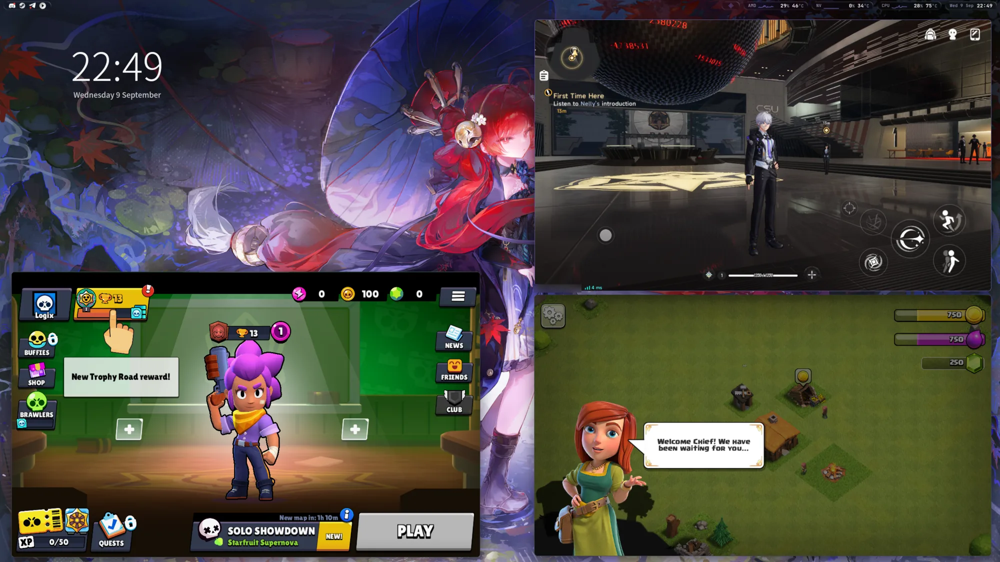
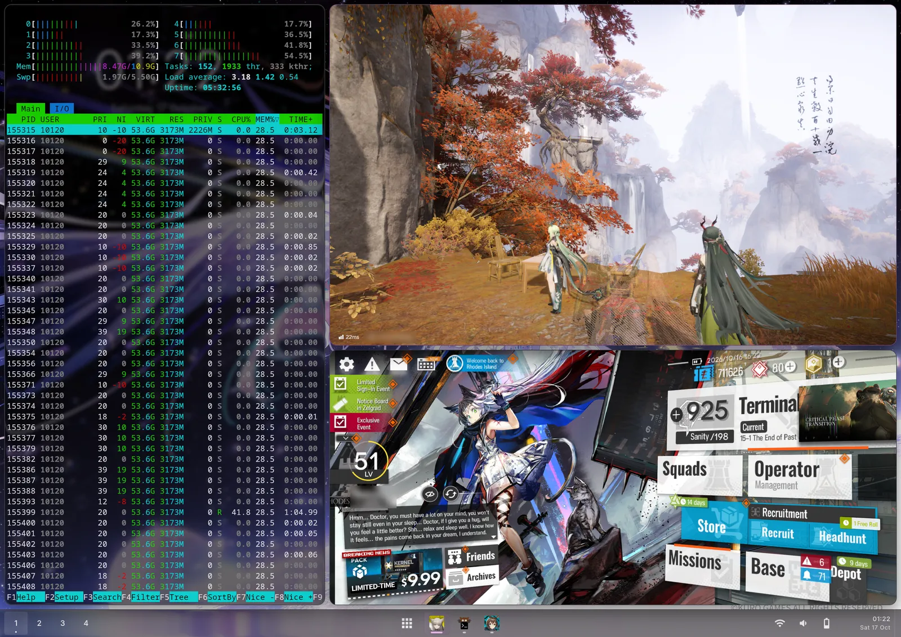

# Droidloom

Droidloom runs Android apps as separate Linux Wayland windows. Android's own
userspace (ART, Binder, Zygote and system_server) runs on your Linux kernel in
its own namespaces: no virtual machine, no emulator and no Android desktop in a
box. Each app gets its own window with GPU acceleration and zero-copy buffers,
next to your other apps.

<p align="center">
  
</p>

This is an early preview. Prebuilt pacman packages are published for x86_64
Arch Linux and aarch64 Arch Linux ARM. Download them from the
[latest release](https://github.com/denialwm/droidloom/releases/latest), or
install them through the repository as below.

> [!NOTE]
> NVIDIA GPUs are supported on x86_64 through [GPU forwarding](docs/gpu-forwarding.md):
> Android's Vulkan and OpenGL ES run on the host's NVIDIA driver. Setup turns it
> on by itself when it finds an NVIDIA GPU.

## What you get

- **One window per app.** Every Android task is its own `xdg_toplevel`. Tile
  it, resize it, move it between workspaces or close it from your compositor;
  Android lays the app out again at the new size.
- **Real Android, no VM.** Android runs on the host kernel with a private
  binderfs instance. Its apps show up in `htop` as ordinary processes.
- **Zero-copy graphics.** App buffers reach the compositor as DMA-BUFs with
  `linux-drm-syncobj` fences. Eligible layers skip SurfaceFlinger's own
  composition: the compositor samples the app's buffers directly, with no
  intermediate render and no copy.
- **ARM apps on x86_64.** The x86_64 image includes
  [Teto](https://github.com/denialwm/teto), an open-source ARM64 translator
  based on Android's Berberis, so ARM-only apps and games run on a desktop PC.
  On aarch64 machines apps run natively.
- **In your app launcher.** Installed Android apps become desktop entries with
  names and icons, updated as you install and remove them.
- **Clipboard both ways.** Text, links, HTML, images and copied files move
  between Android and Linux apps.
- **Desktop notifications.** Android notifications appear as desktop
  notifications. Clicks and actions open the app; dismissing one on the desktop
  clears it in Android.
- **Your folders.** Android's Download, Pictures, Documents, Music and Movies
  are your own Linux folders. A file you save on Linux shows up in Android's
  gallery and file pickers within a second.
- **Your keyboard.** Text fields use the compositor's input method through
  `zwp_text_input_v3`; Android never draws a keyboard of its own.
- **Sound through PipeWire.** The microphone stays off until you allow it.
- **Desktop or mobile windows.** Desktop mode opens phone-sized windows and
  remembers each app's size; mobile mode fills the screen. Choose per app.
- **Performance hints honored.** Android's frame threads report their work to
  Droidloom's power HAL, which raises their CPU utilization floor while they
  draw, so a burst of drawing does not start on a slow core at its lowest
  frequency.
- **Debuggable without sudo.** `droidloomctl logs` and `droidloomctl crashes`
  work as your user, even while Android is still booting.

Apps run so far include WhatsApp, Telegram, Discord, Firefox, TikTok, Google
Play, Arknights, Arknights: Endfield, Brawl Stars, Clash of Clans and Neverness
to Everness.

<p align="center">
  
  <br>
  <em>Brawl Stars, Neverness to Everness and Clash of Clans on an x86_64 desktop.
  All three are ARM64 builds, translated by Teto.</em>
</p>

## Any Wayland compositor

Droidloom needs only standard protocols: `xdg-shell`, `linux-dmabuf` v4 and
`linux-drm-syncobj`. It has been tested on Hyprland and
[Denial](https://github.com/denialwm/denial).

A compositor can do more through three optional, product-neutral protocols.
Denial implements them, and any compositor can:

- **Insets** (`denial_insets_v1`): the compositor reports its status bar and
  navigation areas, and apps lay out around them through ordinary
  `WindowInsets`, as on a phone.
- **Frame timeline** (`denial_frame_timeline_v1`): each frame is granted with a
  latch deadline, so Android renders for the exact refresh the compositor will
  show instead of running its own timer.
- **On-screen keyboard** (`denial_text_input_panel_v1`): Android's show and
  hide keyboard requests drive the compositor's on-screen keyboard.

Their contracts are in [docs/contracts](docs/contracts).

<p align="center">
  
  <br>
  <em>Arknights: Endfield and Arknights next to htop on a OnePlus Pad 4 running
  Denial. htop lists the game as an ordinary Linux process.</em>
</p>

## Install the preview

Follow the **[step-by-step installation guide](docs/INSTALL.md)**, including
first-time setup and **[installing APKs](docs/INSTALL.md#5-install-an-apk)**.

1. Download and review the installer:

   ```console
   curl -fLO https://denialwm.github.io/droidloom/install.sh
   less install.sh
   ```

2. Run `sh install.sh` to add the pacman repository and install or update both
   packages. It picks the x86_64 or aarch64 repository for your machine, asks
   for administrator access and keeps pacman's confirmation before a full
   system upgrade. Droidloom packages are currently unsigned over HTTPS; this
   policy is scoped to the Droidloom repository. Later updates arrive through
   normal `sudo pacman -Syu`.
3. From your normal Wayland desktop terminal, run `droidloomctl start`. First start
   requests administrator authentication to create Android data, runtime
   configuration and the system-service permission. The guide includes an explicit
   setup command if the authentication prompt is unavailable.
4. Try `droidloomctl launch com.android.settings`, then install your APKs with
   `droidloomctl install /path/to/application.apk`.

Startup is manual; launching an app does not start a stopped runtime. Google
apps are not included; an experimental
[builder](docs/BUILDING.md#optional-google-apps) can add them from archives you
supply. Read **[known issues](docs/KNOWN_ISSUES.md)** for compatibility limits
and workarounds.

## Use Droidloom

```console
droidloomctl start                      # or: droidloomctl start --mode mobile
droidloomctl applications
droidloomctl install ~/Downloads/app.apk
droidloomctl launch com.android.settings
droidloomctl window-mode windowed --width 900 --height 1200 --package org.mozilla.firefox
droidloomctl dpi 160
droidloomctl logs com.whatsapp -n 500
droidloomctl crashes
droidloomctl stop
```

`install` updates an app that is already installed and keeps its data. See
[desktop integration](docs/desktop-integration.md) for windows, clipboard,
notifications and diagnostics.

## Build it yourself

The **[build guide](docs/BUILDING.md)** covers prerequisites, disk space and package
checks. One Rust command builds the modified Android components, host binaries
and both pacman packages, without host sudo:

```console
cargo run --locked -j 1 -p droidloom-package -- build
```

Add `--architecture aarch64 --sysroot PATH` to cross-build the aarch64 packages
on the same x86_64 machine.

## Development

- [Documentation](docs/README.md): architecture, desktop integration and contracts.
- [Tools](tools/README.md): package builder, source updater and specialist helpers.
- `runtime/`: supervisor, CLI, application catalog and installation support.
- `graphics/`: Wayland presenter, input, Composer and private host transport.
- `android/`: Android components, patches and pinned upstream inputs.
- `protocol/`: the private Android-to-host wire protocol.
- `packaging/`: pacman metadata, service units and lifecycle integration.

Run `cargo check --locked --workspace -j 1` to check host Rust code. This does not
build Android or install anything. Generated sources, images and packages are
not tracked in Git.

Droidloom's original code is **GPL-3.0-or-later**. See [LICENSE](LICENSE),
[the complete GPLv3 text](LICENSES/GPL-3.0-or-later.txt) and
[third-party licenses](THIRD_PARTY.md).
